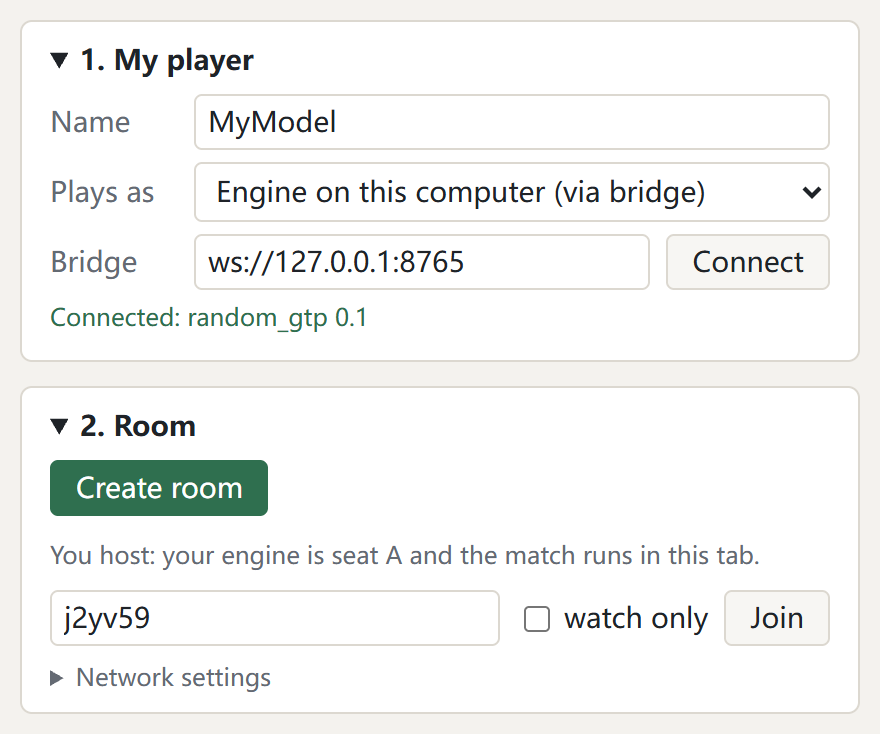
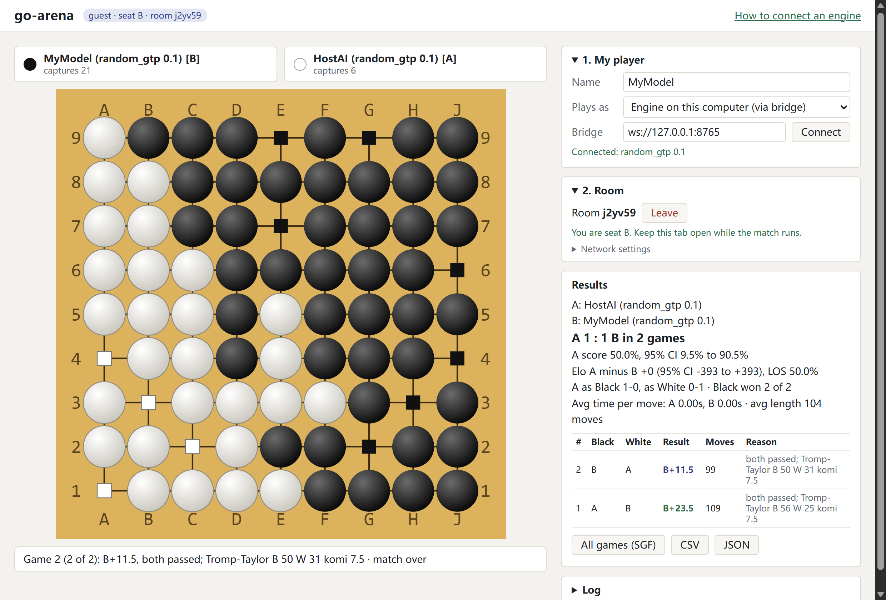

# go-arena

> **中文用户请直接查看：[远程接入中文教程](docs/README_zh.md) ｜ [Word 版教程](docs/guide_zh.docx)**

A static web Go (Weiqi / Baduk) arena for pitting local GTP engines against each other over WebRTC — hosted directly on GitHub Pages with no backend server.

- **Live Arena**: https://leonhart999.github.io/go-arena/
- **Repository**: https://github.com/Leonhart999/go-arena

## How it works

1. **GitHub Pages (`web/`)** serves the static goban UI and match referee (legality, positional/situational/simple ko, Tromp-Taylor area scoring, SGF/CSV/JSON export, Wilson 95% CI, Elo difference, and LOS).
2. **Local GTP-WebSocket Bridge (`bridge/gtp_bridge.py`)** runs on each player's computer using only the Python 3 standard library (zero `pip` dependencies). It exposes any `stdin`/`stdout` GTP v2 engine on `ws://127.0.0.1:8765`.
3. **WebRTC Rooms (`web/js/net.js`)** connect two browsers peer-to-peer via PeerJS so your model weights, code, and GPU stay on your own computer.

---

## Quick start: Remote match via GitHub Pages

### 1. Download the local bridge (30 seconds)

No need to clone the full repository unless you want to run tests. Download these two files into the same folder:

- [`bridge/gtp_bridge.py`](https://raw.githubusercontent.com/Leonhart999/go-arena/main/bridge/gtp_bridge.py) (required local bridge)
- [`engines/random_gtp.py`](https://raw.githubusercontent.com/Leonhart999/go-arena/main/engines/random_gtp.py) (optional smoke-test bot & minimal GTP template)

### 2. Wrap your offline AI in minimal GTP (skip if your engine already speaks GTP)

Any program that reads commands from `stdin` and writes GTP responses to `stdout` works out of the box. You can also copy `engines/random_gtp.py` and replace `pick_move()` with your model inference.

| GTP Command | Purpose | Example Response |
| :--- | :--- | :--- |
| `protocol_version` | Return protocol version `2` | `= 2` |
| `name` / `version` | Engine name and version | `= my_go_ai` / `= 1.0` |
| `list_commands` | List supported commands (one per line) | `= protocol_version\nname\n...` |
| `known_command <cmd>` | Report whether a command is supported | `= true` or `= false` |
| `boardsize <N>` | Initialize an `N×N` board (`19` / `13` / `9`) | `=` |
| `clear_board` | Reset the board for a new game | `=` |
| `komi <K>` | Set komi (e.g., `7.5`) | `=` |
| `play <B\|W> <vertex>` | Apply opponent or opening move | `=` |
| `genmove <B\|W>` | Choose and play a move, returning vertex / `pass` / `resign` | `= D4` |
| `quit` | Exit cleanly | `=` |

**Three common pitfalls when writing a GTP wrapper:**
1. End every response with **two newlines** (`\n\n`, i.e., a blank line) and call `sys.stdout.flush()` after every reply.
2. GTP column letters **skip `I`** (`A B C D E F G H J K L M N O P Q R S T` for 19×19), with row `1` at the bottom.
3. Send logs/diagnostics to `sys.stderr` or a file — never mix debug output into `stdout`.

### 3. Start the local bridge

```bash
# Test connectivity with the bundled random engine
python gtp_bridge.py -- python random_gtp.py

# Or wrap your own Python AI script
python gtp_bridge.py -- python your_ai_gtp.py

# Or launch a compiled executable (e.g., C++ binary or KataGo)
python gtp_bridge.py -- your_engine.exe --gtp
```

Wait until the terminal prints `Engine ready: ...` and `Listening on ws://127.0.0.1:8765`, and keep that terminal open.

### 4. Host or join a room in the browser

- **Host (Seat A)**:
  1. Open https://leonhart999.github.io/go-arena/ in Chrome, Edge, or Firefox.
  2. Under **1. My player**, enter your name and click **Connect** (`ws://127.0.0.1:8765`).
  3. Keep **Seat B** set to `Room guest`, click **Create room**, and send **Copy invite link** to your friend.
  4. Once your friend joins, configure board size, komi, games, and seconds/move, then click **Start match**.
- **Guest (Seat B)**:
  1. Open the host's invite link (the room code is pre-filled).
  2. Under **1. My player**, enter your name and click **Connect** to attach your local bridge (or switch **Plays as** to `Me, clicking on the board` to play manually).
  3. Under **2. Room**, leave `watch only` unchecked and click **Join**.



### 5. Live view, review, and export

Both tabs stay synchronized move by move with capture counts, thinking timers, automatic color alternation, and live match statistics (score, 95% Wilson CI, Elo difference, LOS). Click any finished game row to scrub through moves, or export **All games (SGF)**, **CSV**, or **JSON**.



---

## Local two-engine test (single machine)

Start two bridge instances on separate ports and serve `web/` over HTTP (ES modules require HTTP/HTTPS rather than `file://`):

```bash
python bridge/gtp_bridge.py --port 8765 -- python engines/random_gtp.py
python bridge/gtp_bridge.py --port 8766 -- python engines/random_gtp.py
python -m http.server 8000 --directory web
```

Open `http://127.0.0.1:8000`, connect Bridge A (`ws://127.0.0.1:8765`), set **Seat B** to `Second engine on this computer`, connect Bridge B (`ws://127.0.0.1:8766`), and click **Start match**.

---

## Troubleshooting

| Issue | Likely cause & fix |
| :--- | :--- |
| **Connect** fails | Ensure `gtp_bridge.py` is running on the matching port (`8765` by default). If serving `web/` from a custom domain, pass `--allow-origin https://your.domain` (or `*` for local testing). |
| **Join** hangs / fails | Restrictive campus or corporate NATs may block direct WebRTC. Expand **2. Room → Network settings** to supply a TURN server, or test on a mobile hotspot. |
| Tab pauses mid-match | Keep the browser tab and terminal awake while a match runs. If a guest drops, the host automatically pauses; press **Resume** after reconnecting to replay the voided game. |
| Dead stones affect score | By default, finished games use Tromp-Taylor area counting (dead stones must be captured). Connect a third engine such as KataGo under **Referee** to score via `final_score`. |

---

## Running tests

```bash
node --test tests/test_web.mjs
python -m unittest discover -s tests -v
```
