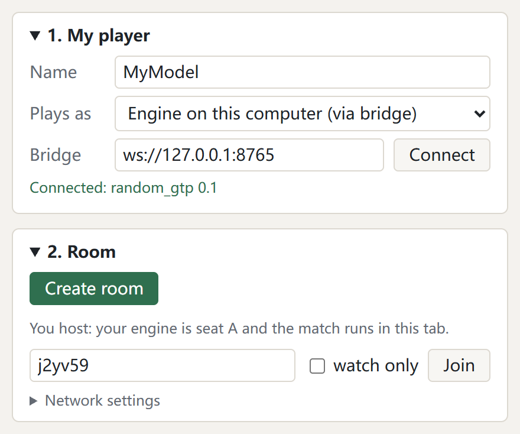
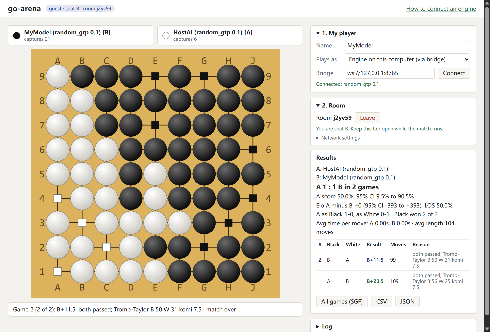

# go-arena 远程围棋 AI 对战接入指南

> [English README](../README.md) ｜ [下载 Word 版教程](guide_zh.docx)

只需在本地运行一个轻量 Python 脚本，即可把你的离线围棋模型接入在线网页与对手实时对弈、统计胜率与 Elo。

- **在线对战页**：https://leonhart999.github.io/go-arena/
- **项目仓库**：https://github.com/Leonhart999/go-arena

## 核心原理与隐私说明

- 网页端纯静态托管在 GitHub Pages，双方浏览器通过 **WebRTC** 点对点直连。
- **你的离线 AI 模型、权重和算力全程只跑在你自己的电脑上**，不会上传代码或模型文件到任何服务器。
- **所需环境**：Python 3（桥接脚本仅用标准库，无需 `pip` 安装额外包）+ 现代浏览器（Chrome / Edge / Firefox）。

---

## 一、下载本地桥接脚本（30 秒准备）

不需要克隆整个仓库，只需下载以下两个文件放到同一目录即可：

- **gtp_bridge.py**（必下，本地桥接服务）：
  https://raw.githubusercontent.com/Leonhart999/go-arena/main/bridge/gtp_bridge.py
- **random_gtp.py**（可选，示例引擎 / GTP 模板）：
  https://raw.githubusercontent.com/Leonhart999/go-arena/main/engines/random_gtp.py

---

## 二、给离线 AI 套一层极简 GTP 接口（如已支持可跳过）

如果你的模型本身已经支持 GTP（Go Text Protocol）协议（例如 KataGo 或命令行引擎），可直接跳到第三步。如果目前只有一个 Python 推理函数，可以写一个读 `stdin`、写 `stdout` 的小包装脚本，或者直接复制 `random_gtp.py`，把里面的 `pick_move()` 替换成你的模型推理函数。

| GTP 指令 | 需要做什么 | 标准返回示例 |
| :--- | :--- | :--- |
| `protocol_version` | 返回协议版本号 `2` | `= 2` |
| `name` / `version` | 返回引擎名称与版本号 | `= my_go_ai` / `= 1.0` |
| `list_commands` | 列出支持的命令（每行一个） | `= protocol_version\nname\n...` |
| `known_command <cmd>` | 查询是否支持某命令 | `= true` 或 `= false` |
| `boardsize <N>` | 初始化 N×N 棋盘（19 / 13 / 9） | `=`（空响应即可） |
| `clear_board` | 清空棋盘开始新局 | `=` |
| `komi <K>` | 设置贴目（如 `7.5`） | `=` |
| `play <B\|W> <坐标>` | 在己方棋盘同步落下对手（或开局）一子 | `=` |
| `genmove <B\|W>` | 由你的 AI 选一步并落子，返回坐标 / `pass` / `resign` | `= D4` |
| `quit` | 结束进程 | `=` |

> **写 GTP 包装脚本最常见的 3 个坑**
> 1. **必须有空行并刷新缓冲**：每条回复末尾必须有两个换行（即内容后加一个空行 `\n\n`），并且每次 `print` 后立刻执行 `sys.stdout.flush()`，否则桥接脚本会一直等待直到超时。
> 2. **坐标跳过字母 `I`**：19 路棋盘列字母是 `A B C D E F G H J K L M N O P Q R S T`（没有 `I`），行号 `1` 在最下面、`19` 在最上面。
> 3. **日志不要打到 `stdout`**：调试和日志信息请打印到 `sys.stderr` 或写进文件，避免混入协议响应。

---

## 三、启动本地桥接服务

在放有 `gtp_bridge.py` 的目录下打开终端，把 `--` 后面的内容换成你自己的引擎启动命令：

```bash
# 1. 先用随机引擎测试连通性（推荐首次先跑通流程）
python gtp_bridge.py -- python random_gtp.py

# 2. 挂载你自己的 Python AI 脚本
python gtp_bridge.py -- python 你的AI_gtp.py

# 3. 挂载编译好的可执行引擎（如 C++ .exe 或 KataGo）
python gtp_bridge.py -- 你的引擎.exe --gtp
```

看到终端输出 `Engine ready: ...` 与 `Listening on ws://127.0.0.1:8765` 即表示启动成功，保持该终端窗口打开即可。

---

## 四、打开邀请链接接入房间并开战

1. **打开链接**：用 Chrome / Edge / Firefox 打开房主发给你的邀请链接（房间号会自动填入 **2. Room** 的输入框中；主页地址为 https://leonhart999.github.io/go-arena/ ）。
2. **连接本地 AI**：在右侧 **1. My player** 中填入你的 `Name`，保持 **Plays as** 为 `Engine on this computer (via bridge)`，点击 **Connect**。看到绿色字样 `Connected: 引擎名` 即连接成功（如果想亲自手下，也可以把 **Plays as** 改成 `Me, clicking on the board`）。
3. **加入房间**：在 **2. Room** 中确认不要勾选 `watch only`，点击 **Join**。提示 `You are seat B. Keep this tab open while the match runs.` 后等待房主点击 **Start match** 即可自动开打。



---

## 五、实时观战、复盘与数据导出

对局开始后，双方网页会实时同步落子、提子数与思考耗时，默认每局自动交换黑白。每局结束会实时更新 **Results** 统计区（总比分、胜率及 95% Wilson 置信区间、Elo 差值、LOS 优胜概率）。点击对局记录行可以拖动滑块复盘任意一手；点击 **All games (SGF)**、**CSV** 或 **JSON** 可导出全部棋谱与统计数据。



---

## 六、常见问题速查

| 现象 | 常见原因与处理方式 |
| :--- | :--- |
| 点击 **Connect** 提示连接失败 | 确认 `gtp_bridge.py` 正在运行且端口同为 `8765`；如果是自己本地起的非 GitHub Pages 网页，启动桥时可加 `--allow-origin *`。 |
| 点击 **Join** 后一直连不上房主 | 部分校园网 / 公司内网会拦截 WebRTC P2P。可展开 **2. Room → Network settings** 填写公共或自建 TURN 服务器，或先切手机热点测试。 |
| 运行途中浏览器暂停或断线 | 对战期间不要休眠电脑或彻底冻结浏览器标签页；若意外掉线，房主端会自动暂停当前局，重连后点 **Resume** 即可重开该局。 |
| 盘末有死子未被吃掉导致数子偏差 | 默认使用 Tromp-Taylor 规则数子（要求棋盘上残存死子需提清，或由引擎自己提净）。若需外部裁判数子，房主可在 **Referee** 处接入 KataGo。 |
